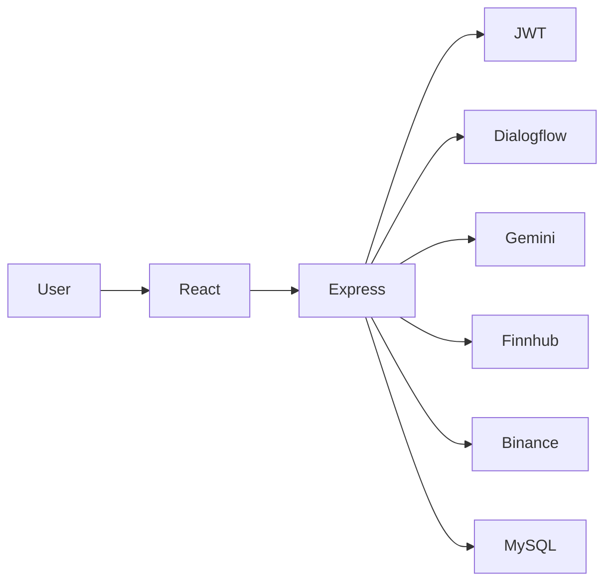

# FinAdvisor

AI-Powered Financial Assistant

FinAdvisor is a full-stack web application that allows users to query real-time financial data (Stocks, Crypto, Forex) using natural language. It combines the reasoning capabilities of Google Gemini with intent classification from Dialogflow to provide an intelligent conversational interface for financial data.

**Disclaimer:** This is an educational/information platform. The application does not provide personalized financial advice or guarantee investment returns. Market data is provided for educational purposes only.

## Features

- **Conversational AI Interface**: Ask financial questions naturally.
- **Real-time Market Data**: Get current prices for stocks, cryptocurrencies, and forex pairs.
- **Persistent Chat History**: Previous conversations are saved and accessible.
- **Secure Authentication**: JWT-based user authentication.
- **Financial Dashboard**: Overview of major market indices and user watchlist.

## Architecture



## Tech Stack

- **Frontend**: React.js, Vite, Tailwind CSS, React Router, Recharts, Lucide React
- **Backend**: Node.js, Express.js, JWT, bcrypt
- **Database**: MySQL (using `mysql2`)
- **AI/NLP**: Google Gemini API, Google Dialogflow
- **Financial APIs**: Finnhub (Stocks), Binance (Crypto), Frankfurter (Forex)

## Screenshots

*(Add screenshots of your application here after running it)*

- Login/Register Page
- Dashboard
- Chat Interface

## Setup and Installation

### Environment Variables

Create `.env` files in both backend and frontend directories based on the `.env.example` templates.

**backend/.env**
```env
PORT=5000
DB_HOST=localhost
DB_USER=root
DB_PASSWORD=root
DB_NAME=finadvisor
JWT_SECRET=your_secure_jwt_secret
GEMINI_API_KEY=your_gemini_api_key
FINNHUB_API_KEY=your_finnhub_api_key
BINANCE_API_URL=https://api.binance.com/api/v3
DIALOGFLOW_PROJECT_ID=your_dialogflow_project_id
DIALOGFLOW_CLIENT_EMAIL=your_dialogflow_client_email
DIALOGFLOW_PRIVATE_KEY="your_dialogflow_private_key"
```

### Running Locally (Without Docker)

1. **Database Setup**:
   Create a MySQL database named `finadvisor` and run the SQL script located in `database/schema.sql`.

2. **Backend**:
   ```bash
   cd backend
   npm install
   npm run dev
   ```

3. **Frontend**:
   ```bash
   cd frontend
   npm install
   npm run dev
   ```

### Docker Setup

You can run the entire stack (MySQL, Backend, Frontend) using Docker Compose.

```bash
docker compose up --build
```
This will automatically create the database and run the schema initialization script.

## External Service Setup

### Dialogflow Setup
1. Create a project in Google Cloud Console.
2. Enable the Dialogflow API.
3. Create a Service Account, generate a JSON key, and extract the `project_id`, `client_email`, and `private_key` for your `.env` file.
4. Create an agent in Dialogflow ES and define intents (`STOCK_QUERY`, `CRYPTO_QUERY`, `FOREX_QUERY`).

### Gemini Setup
1. Go to Google AI Studio.
2. Create an API key and add it to `GEMINI_API_KEY`.

### Finnhub Setup
1. Register at Finnhub.io.
2. Get your free API key and add it to `FINNHUB_API_KEY`.

## API Documentation
See `docs/FinAdvisor.postman_collection.json` for full API documentation.

## Testing
To run backend tests:
```bash
cd backend
npm test
```

## Security
- Passwords hashed with bcrypt.
- JWT used for secure session management.
- API keys stored securely in `.env` and never exposed to the frontend.
- Cross-Origin Resource Sharing (CORS) configured.

## Future Improvements
- Implement caching for frequent stock queries (e.g., Redis).
- Add more advanced data visualizations with Recharts.
- Support more complex portfolio analysis queries.
