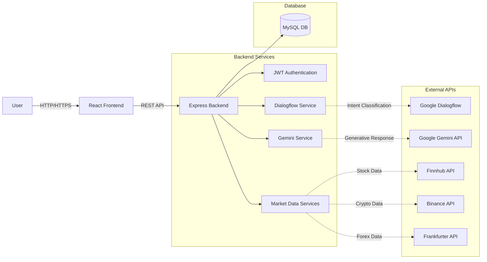

# FinAdvisor Architecture

## System Components

1. **Frontend**: React application built with Vite and Tailwind CSS.
2. **Backend**: Node.js/Express RESTful API.
3. **Database**: MySQL used for storing users, chat history, and watchlists.
4. **AI Layer**: Gemini (Natural Language Generation) + Dialogflow (Intent Classification).
5. **Data Layer**: Finnhub (Stocks), Binance (Crypto), Frankfurter (Forex).
